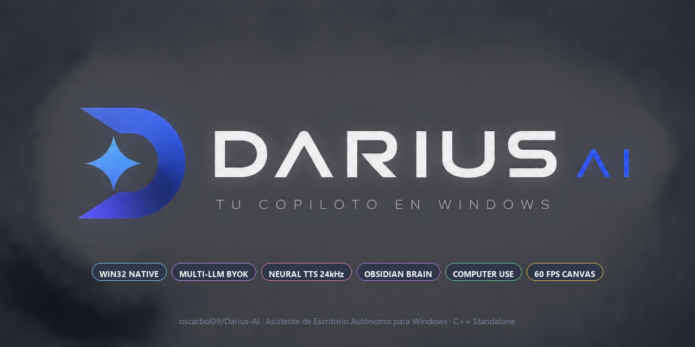

<p align="center">
  
</p>

# Darius AI

<p align="center">
  <a href="https://github.com/oscarbol09/Darius-AI/releases/latest"></a>
  <a href="https://github.com/oscarbol09/Darius-AI"></a>
  <a href="https://oscarbol09.github.io/Darius-AI/"></a>
  <a href="https://github.com/oscarbol09/Darius-AI/releases/latest"></a>
</p>

> 📖 **Sitio Web de Documentación Oficial:** [oscarbol09.github.io/Darius-AI](https://oscarbol09.github.io/Darius-AI/)  
> 🚀 **¿Quieres usar Darius AI sin instalar Python?** Descarga el instalador oficial **[DariusAI-Setup-Latest.exe](https://github.com/oscarbol09/Darius-AI/releases/latest)** en la sección de Releases. Se instala en segundos en tu equipo sin requerir permisos de administrador.

**Darius AI** es un asistente de escritorio por voz y automatización nativa para Windows con arquitectura BYOK (*Bring Your Own Key*), automatización antropomórfica de GUI (*Computer Use*), cerebro de memoria en Obsidian y renderizado visual a 60 FPS.

---

## ¿Por qué existe Darius AI?

La mayoría de asistentes virtuales dependen exclusivamente de servicios en la nube cerrados para cualquier tarea elemental, lo que genera latencia innecesaria, consumo constante de cuota y fallos al perder conexión.

Darius AI se basa en dos pilares de ingeniería:

1. **Localidad primero:** Los comandos del sistema operativo (abrir aplicaciones, ajustar volumen, consultar diagnósticos de red, escribir notas diarias o buscar en tu historial) se resuelven **100% en local** en milisegundos a través de las APIs de Windows, PowerShell y tu bóveda de **Obsidian**, sin enviar tráfico a internet.
2. **Libertad de modelo (BYOK):** Para consultas abiertas y razonamiento en lenguaje natural, puedes conectar el proveedor de IA que prefieras (Google Gemini, OpenAI / ChatGPT, OpenRouter, NVIDIA NIM, Groq o instancias locales de **Ollama** sin costo alguno ni salida a internet).

---

## Capacidades y Arquitectura de Módulos

- **Suite de Inteligencia Situacional y Telemetría Global:**
  - **Radar Orbital y Rastreo ISS (`orbital_radar.py`):** Telemetría cinemática de la Estación Espacial Internacional (ISS) en tiempo real consumiendo APIs abiertas con Anti-SSRF, distancia geodésica esférica (fórmula de Haversine) y marcación azimutal respecto a tu ubicación.
  - **Centinela de Tráfico Aéreo ADS-B (`air_traffic_sentinel.py`):** Escaneo táctico de aeronaves en el espacio aéreo circundante mediante transpondedores OpenSky Network y adsb.lol (callsign, altitud barométrica, velocidad, rumbo y proximidad).
  - **Sensor Sísmico y Tectónico Global (`seismic_sensor.py`):** Monitorización en tiempo real de terremotos vía USGS GeoJSON ($M \ge 4.5$) con detección de alertas de tsunami.
  - **Oráculo de Clima Espacial y Tormentas Solares (`space_weather_oracle.py`):** Índice Kp planetario de NOAA SWPC, categorización de tormentas geomagnéticas (G0 a G5) y evaluación de impacto en telecomunicaciones y satélites.
  - **Telemetría Acústica Earcon y Sonar Ping (`sound_effects.py`):** Pulso acústico discreto de dos tonos (880 Hz / 1320 Hz) para telemetría en segundo plano y Sonar Ping cibernético procedural (480 Hz / 960 Hz).
- **Personalidad Canónica Darius y Motor de Agudeza Británica (`darius_persona.py`):**
  - Personalidad de copiloto mayordomo de alta inteligencia: cortesía británica inalterable, honorífico *"señor"*, agudeza seca (*dry wit*) y rigor analítico.
  - Motor local de réplicas de humor sin latencia de red (`get_witty_retort`) y filtrado anti-*AI slop* con cadencia digna para TTS (`format_butler_response`).
- **HUD Cyber Core Visualizer a 60 FPS (`cyber_core_visualizer.py`):**
  - Visualizador vectorial sobre `tk.Canvas` con geometría polar precomputada en NumPy: anillo exterior segmentado de 12 arcos, escala táctica de 36 marcas en contrarrotación y núcleo central pulsante modulado por RMS de audio.
  - Paleta cromática Cyber Core: Core Cyan (`#00F0FF`), Core Amber (`#E6AA38`), Core Crimson (`#C42B3B`), Core Emerald (`#00FF88`).
- **Control Multimedia Global Win32 (`media_controller.py`):**
  - Despachador de Virtual Keys (VK) mediante `user32.dll keybd_event` para Spotify, YouTube, VLC y reproductores globales sin requerir foco de ventana (`play_pause`, `next`, `prev`, `stop`, `vol_up`, `vol_down`, `mute`).
- **Protocolo de Diagnóstico Integral Darius (`darius_protocol.py`):**
  - Auditoría multivariable de sistemas: CPU, RAM, disco, energía AC/batería, latencia de red, geometría de pantallas, periféricos de audio y bóveda de Obsidian.
  - Secuencia de audio procedural sincronizada y alocución verbal de alta precisión (*"Protocolo de Diagnóstico Integral Darius ejecutado con éxito, señor..."*).
- **Oráculo Científico y Lookup Enciclopédico Rápido (`science_oracle.py`):**
  - Resúmenes enciclopédicos con latencia reducida (<200 ms) vía Wikimedia REST API y base de datos de 15 constantes físicas fundamentales y 10 conversiones técnicas (Mach, eV, PSI, años luz, nudos).
- **Centinela de Inteligencia de Noticias (`news_sentinel.py`):**
  - Monitor asíncrono y resiliente de titulares con degradación graciosa (NewsAPI -> feeds RSS sindicados -> DuckDuckGo News), validación Anti-SSRF y alocución para briefings.
- **Oráculo Léxico y Diccionario Bilingüe (`lexicon_oracle.py`):**
  - Diccionario técnico bilingüe curado (IA, computación, física) + Free Dictionary API con fonética IPA, sinónimos y búsqueda difusa tolerante a fallos.
- **Biometría Facial y Autenticación Sentry Darius (`face_biometrics.py`):**
  - Verificación biométrica con métrica normalizada $[0.0, 1.0]$, fallback 3-tier (Óptico -> Desafío vocal/PIN -> Headless seguro) y alocución canónica de identidad.
- **Extracción Visual OCR e Inteligencia de Pantalla (`visual_intel_ocr.py`):**
  - Pipeline de preprocesamiento (CLAHE + Otsu) con descubrimiento dinámico de motor OCR en cascada (WinRT nativo -> Tesseract -> LLM multimodal) y extractor de stacktraces/código.
- **Director de Medios y Reproducción en YouTube (`media_controller.py`):**
  - Limpieza de consultas en lenguaje natural, apertura delegada en el navegador predeterminado del sistema y comando de auto-reproducción.
- **Motor de Temporizadores Tácticos Darius (`darius_timer.py`):**
  - Cuentas regresivas y alarmas multihilo con resolución milimétrica (<0.05s), alerta acústica procedural al expirar y alocución vocal estilizada de Darius.
- **Pila de Sub-Diálogos LIFO Darius (`dialogue_stack.py`):**
  - Autómata de pila pushdown LIFO para gestionar sub-diálogos anidados y confirmaciones interactivas con fast-path inteligente afirmativo/negativo y expiración temporal.
- **Despachador Wake-on-LAN Multi-NIC (`wol_dispatcher.py`):**
  - Emisión de Magic Packets UDP RFC a través de todas las interfaces activas y difusiones dirigidas para encender rigs de juego, servidores y NAS locales.
- **Protocolo de Silencio Táctico y Bloqueo de Emergencia Darius (`darius_lockdown.py`):**
  - Silencio táctico instantáneo (<15 ms), flush y checkpoints WAL en SQLite, y bloqueo de estación de trabajo Windows vía Win32 `user32.LockWorkStation()`.
- **Disparador Acústico por Doble Aplauso:**
  - Detección en tiempo real de picos acústicos transitorios (aplausos) sobre streaming PCM con `sounddevice` y `numpy`.
  - Piso de ruido adaptativo exponencial que ajusta el umbral automáticamente al entorno sonoro.
  - Auto-sondeo inteligente de micrófonos (`probe_best_input_device`): detecta si el micro predeterminado está mudo (RMS < 0.001) y conmuta al dispositivo activo óptimo.
- **Gestión Multi-Monitor Win32 y Rutinas de Espacio de Trabajo:**
  - Descubrimiento nativo de pantallas vía `EnumDisplayMonitors` y `GetMonitorInfoW`.
  - Colocación y ajuste de navegadores y ventanas en monitores específicos (`snap_window_to_monitor`).
  - Enfoque nativo de IDEs (`Cursor.exe`, `Code.exe`) mediante `AttachThreadInput` y `SetForegroundWindow` para evitar procesos duplicados.
  - Rutinas automatizadas: **"Protocolo Darius"** (preparación y bienvenida completa), **"Modo Desarrollo"** (IDE monitor 1 + Docs monitor 2) y **"Modo Trading"** (TradingView + Finviz/Binance).
- **Motor TTS ElevenLabs y Configuración Gráfica Total:**
  - Síntesis neural de alta fidelidad con streaming PCM 24kHz y fallback a REST.
  - Almacenamiento local en disco (`audio_cache/`) indexado por hash SHA-256: las frases de estado y saludos recurrentes se reproducen al instante (0 ms de latencia) y con 0 consumo de cuota de API.
  - Despachador multi-motor dinámico: ElevenLabs > Edge-TTS > SAPI5 local (SAPI5 funciona offline sin configuración previa).
- **Modal Gráfico Dual de Configuración (`⚙ Configuración`):**
  - **Pestaña 1 (Modelo de IA - BYOK):** Soporte para 7 motores (Gemini, OpenAI, Groq, NVIDIA NIM, OpenRouter, Ollama, Personalizado) con ping de latencia en vivo.
  - **Pestaña 2 (Voz y Síntesis - TTS):** Selección de motor (SAPI5, Edge-TTS, ElevenLabs), campo de API Key enmascarado con alternador `👁`, catálogo de voces (Adam, Rachel, Antoni, etc.), modelo neural, alternador de caché local y botón de prueba auditiva en vivo (`🔊 PROBAR VOZ`).
  - Cero necesidad de editar archivos `.env` o JSON manualmente: todo se gestiona y persiste desde la interfaz visual.
- **Empaquetado Nativo `.EXE` para Usuarios Finales:**
  - Compilación nativa en C con **Nuitka** (0 dependencias de Python para el usuario final, 0 falsos positivos de antivirus).
  - Instalador ligero con **Inno Setup** que instala en el perfil del usuario (`%LOCALAPPDATA%`) sin requerir permisos de administrador.
  - Separación de datos: toda la persistencia mutable (`config.json`, logs, cachés) se aísla automáticamente en `%APPDATA%\DariusAI`.
- **Cerebro y Memoria en Bóveda de Obsidian:**
  - **Diario Personal:** Comandos de voz directos (*"Anota en mi diario que..."*) que registran entradas con marca de tiempo en la nota diaria (`Diario/YYYY-MM-DD.md`).
  - **Memorias Permanentes:** Almacena hechos, preferencias y datos de contexto (*"Recuerda que..."*) en archivos Markdown estructurados con frontmatter YAML (`Darius/Memorias/`).
  - **Inyección de Contexto:** El motor de IA recupera automáticamente fragmentos relevantes de tu bóveda para enriquecer las respuestas conversacionales.
- **Visualizador Vectorial a 60 FPS y Telemetría en Vivo:**
  - Onda sinusoidal armónica de 3 capas calculada con **NumPy** y proyectada sobre `tkinter.Canvas` atómico (0 flicker, <90 MB RAM).
  - Indicadores de telemetría en tiempo real: estado del micrófono, monitores detectados, motor TTS y botón de conmutación de aplausos.
- **Motor de Efectos de Sonido Procedurales en Memoria (`sound_effects.py`):**
  - Síntesis matemática directa de tonos senoidales, triangulares y cuadrados con `numpy` y `sounddevice` (0 KB de archivos en disco, latencia <5ms).
  - Confirmaciones tácticas de interfaz (`target_lock`, `success_chime`, `scan_pulse`, `click_tone`) y botón interactivo `🔊 SFX / 🔇 MUTE`.
- **Motor de Dossiers de Inteligencia y OSINT (`target_dossier.py`):**
  - Síntesis automatizada de fichas analíticas sobre personas, empresas y repositorios guardadas en Obsidian (`Darius/Dossiers/`).
  - Extracción de trayectoria, perfiles sociales verificados, *conversation hooks* y señales de riesgo (*risk flags*).
  - Soporte integrado de búsqueda neuronal semántica con **Exa API** (`EXA_API_KEY`).
- **Centinela Perceptual de Presencia Humana (`webcam_sentinel.py`):**
  - Monitoreo pasivo en segundo plano por webcam (<1% CPU) para auto-wake al sentarte, auto-sleep al ausentarte y alerta de hombro (*Shoulder-Surfer Alert*).
- **Barra de Telemetría HUD Agéntica en GUI (`telemetry_bar.py`):**
  - Ticker continuo en tiempo real integrado en el Command Dock que muestra la herramienta activa y su tiempo de respuesta en ms.
- **Resumen Ejecutivo Matutino & Briefing Diario (`daily_digest.py`):**
  - Síntesis hablada (<200 palabras) de telemetría de hardware, tareas pendientes de Obsidian, estado del repo Git y notas recientes con solo decir *"Darius, resumen del día"*.
- **Seguridad Human-in-the-Loop & Control por Tiers (`approval_store.py`):**
  - Almacén SQLite WAL para acciones destructivas o sensibles, con memoria de permisos y aprobación directa por voz (*"sí"*, *"aprobar"*, *"siempre permitir"*).
- **Guardián Anti-Bucles y Compresión de Contexto (`loop_guard.py`):**
  - Hashing determinista SHA-256 de herramientas, detección de ciclos oscilatorios ping-pong y compresión de contexto en 4 etapas.
- **Programador de Tareas Autónomo en Segundo Plano (`task_scheduler.py`):**
  - Automatización con tareas programadas (`interval`, `once`, `cron`) ejecutadas por un hilo daemon ligero.
- **Enrutador de Complejidad y Triage de Modelos (`complexity_router.py`):**
  - Análisis multidimensional de consultas para presupuestar tokens y seleccionar entre modelos locales ultrarrápidos y modelos frontera de razonamiento profundo.
- **Registro de Habilidades Procedimentales en Markdown (`skill_registry.py`):**
  - Extensibilidad dinámica: define nuevas habilidades en notas Markdown con frontmatter YAML sin tocar una sola línea de código Python.
- **Seguridad Perimetral, Anti-SSRF y Scrubber de Credenciales (`security_guard.py`):**
  - Filtro hermético anti-SSRF con validación de subredes privadas RFC 1918 y metadatos de nube.
  - Redactor de credenciales y tokens (`CredentialStripper`) en salidas de consola y respuestas de voz.
  - Escáner de inyecciones de prompt y jailbreaks (`InjectionScanner`) en 4 niveles de severidad.
- **Sandbox AST y Ejecución Segura de Python (`safe_code_interpreter.py`):**
  - Ejecutor Python con validación previa de AST, lista blanca estricta de librerías matemáticas/datos y estado en memoria persistente.
- **Motor de Grafos DAG para Flujos Complejos (`workflow_dag.py`):**
  - Orquestador de flujos acíclicos con ordenamiento de Kahn y ejecución concurrente por fases `execution_stages()`.
- **Agente de Investigación Profunda con Citas (`deep_research_agent.py`):**
  - Deconstrucción de preguntas en subconsultas de búsqueda, deduplicación de fuentes y reportes con citas `[1]`, `[2]`.
- **Gestión Dinámica de Perfil de Usuario (`user_profile_engine.py`):**
  - Extracción automática de preferencias, hábitos y stack tecnológico del usuario en `USER.md` en Obsidian Vault.
- **Búsqueda Web Resiliente con Anti-SSRF y Caché LRU (`web_search_engine.py`):**
  - Búsqueda multi-proveedor con validación de seguridad de URLs y caché in-memory de 15 minutos.
- **Control por Voz y Modos de Activación:**
  - **Disparador Acústico:** Da dos aplausos seguidos para despertar al asistente inmediatamente.
  - **Push-to-Talk (PTT):** Mantén presionada una tecla (`Right Ctrl` por defecto) para hablar sin falsos positivos.
  - **Modo Nombre:** Escucha continua en segundo plano que se activa al detectar el nombre ("Darius").
  - **Modo Auto:** Procesa de forma inmediata cualquier frase capturada.


---

## Requisitos del Sistema

- **Sistema Operativo:** Windows 10 (compilación 19041+) o Windows 11.
- **Python:** 3.11 o 3.12.
- **Audio:** Micrófono y altavoces/auriculares configurados como dispositivos predeterminados en Windows.
- **Obsidian (Opcional):** Si tienes una bóveda de Obsidian, Darius se integra directamente con tu estructura de carpetas.
- **Ollama (Opcional):** Si deseas ejecutar modelos 100% locales sin conexión ni consumo de API externa.

---

## Instalación y Puesta en Marcha

### 1. Clonar el repositorio y preparar el entorno

```powershell
git clone https://github.com/oscarbol09/Darius-AI.git
cd Darius-AI

python -m venv .venv
.venv\Scripts\activate
```

### 2. Instalar dependencias

```powershell
pip install -r requirements.txt
```

### 3. Iniciar el asistente y configurar tu proveedor e IA y Voz
```powershell
python main.py
```

Al abrir Darius AI:
1. Haz clic en el botón **⚙ Configuración** en la esquina superior derecha.
2. **Pestaña 🤖 Modelo de IA (BYOK):**
   - Selecciona tu proveedor preferido (**Gemini**, **OpenAI**, **Groq**, **NVIDIA NIM**, **OpenRouter**, **Ollama** o **Personalizado**).
   - Introduce tu clave de API (no requerida para Ollama) y presiona **Probar Conexión** para medir la latencia.
3. **Pestaña 🔊 Voz y Síntesis (TTS):**
   - Selecciona el motor (**SAPI5 nativo offline**, **Edge-TTS neural**, o **ElevenLabs**).
   - Si eliges ElevenLabs, ingresa tu API Key, selecciona tu voz favorita (Adam, Rachel, Antoni, etc.) y prueba el audio en vivo con **🔊 Probar Voz**.
4. Haz clic en **Guardar** para aplicar los cambios de inmediato.

---

## Compilación y Empaquetado a Binario Standalone (.EXE)

Darius AI cuenta con un sistema de compilación automatizado a C nativo mediante **Nuitka**, lo que permite distribuirlo a usuarios que no tienen Python instalado:

```powershell
# 1. Instalar dependencias de compilación
pip install nuitka zstandard

# 2. Compilar binario nativo standalone
python build_nuitka.py
```

El script genera la carpeta `dist/main.dist/` que contiene `DariusAI.exe`, sus recursos y librerías DLL empaquetadas.

### Crear el Instalador de Windows (Inno Setup)
Si tienes instalado [Inno Setup 6](https://jrsoftware.org/isdl.php), compila el script para generar el instalador final:

```powershell
iscc installer.iss
```

Esto generará `Output/DariusAI-Setup-Latest.exe`, un instalador ligero que se instala en el directorio de usuario (`%LOCALAPPDATA%\Programs\DariusAI`) sin solicitar permisos de administrador.

### 4. Configurar la Bóveda de Obsidian y Espacio de Trabajo (Opcional)

Puedes personalizar rutas y pantallas en `config.json`:

```json
{
  "obsidian": {
    "vault_path": "C:\\Ruta\\A\\Tu\\Obsidian Vault",
    "daily_notes_folder": "Diario",
    "memories_folder": "Darius/Memorias",
    "auto_inject_context": true
  },
  "tts": {
    "engine": "elevenlabs"
  },
  "elevenlabs": {
    "voice_id": "21m00Tcm4TlvDq8ikWAM",
    "model_id": "eleven_multilingual_v2"
  },
  "acoustic_trigger": {
    "enabled": true,
    "clap_threshold_multiplier": 2.8
  }
}
```

> **Nota para el modo PTT:** La captura global de pulsaciones de teclado mediante la librería `keyboard` requiere ejecutar el terminal o script con **privilegios de administrador** en Windows.

---

## Proveedores LLM Compatibles (BYOK)

| Proveedor | Identificador | Modelo Predeterminado | Endpoint Base | Variable de Entorno |
| :--- | :--- | :--- | :--- | :--- |
| **Google Gemini** | `gemini` | `gemini-3.5-flash-lite` | Google GenAI SDK nativo | `GEMINI_API_KEY` |
| **OpenAI / ChatGPT** | `openai` | `gpt-4o-mini` | `https://api.openai.com/v1` | `OPENAI_API_KEY` |
| **Groq Cloud** | `groq` | `llama-3.3-70b-versatile` | `https://api.groq.com/openai/v1` | `GROQ_API_KEY` |
| **NVIDIA NIM** | `nvidia_nim` | `nvidia/llama-3.1-nemotron-70b-instruct` | `https://integrate.api.nvidia.com/v1` | `NVIDIA_API_KEY` |
| **OpenRouter** | `openrouter` | `openrouter/free` | `https://openrouter.ai/api/v1` | `OPENROUTER_API_KEY` |
| **Ollama (Local)** | `ollama` | `llama3.2:3b` | `http://localhost:11434/v1` | *(No requerida)* |
| **Personalizado** | `custom` | *Configurable* | *Configurable* | *Vía modal o config.json* |

---

## Comandos de Voz y Rutinas de Automatización

| Comando de Voz | Acción Ejecutada | Módulo |
| :--- | :--- | :--- |
| **"Protocolo Darius"** / **"Modo Bienvenida"** | Maximiza IDE Cursor/Code en monitor 1, abre herramientas en monitor 2, ajusta audio y reproduce bienvenida | `src/darius_ai/system/workspace_manager.py` |
| **"Modo desarrollo"** / **"Modo programar"** | Enfoca Cursor/Code en monitor principal y abre documentación técnica en monitor secundario | `src/darius_ai/system/workspace_manager.py` |
| **"Modo trading"** / **"Modo finanzas"** | Abre TradingView y Finviz en monitores 1 y 2 para análisis de mercado | `src/darius_ai/system/workspace_manager.py` |
| **"¿Cuántos monitores tengo?"** | Consulta Win32 `EnumDisplayMonitors` y describe dimensiones, posición y monitor primario | `src/darius_ai/system/workspace_manager.py` |
| **"Organizar pantallas"** / **"Organizar ventanas"** | Distribuye las ventanas principales en cuadrícula según la topología multi-monitor | `src/darius_ai/system/workspace_manager.py` |
| **"Pantalla completa"** / **"F11"** | Envía tecla `F11` a la ventana activa mediante eventos de teclado de Windows | `src/darius_ai/system/workspace_manager.py` |
| **"¿Qué hay en mi pantalla?"** / **"Analiza mi pantalla"** | Captura atómica con `mss` y análisis visual multimodal con el LLM activo | `src/darius_ai/core/screen_vision.py` |
| **"Analiza este error en pantalla"** | Detecta stacktraces, diálogos de error y fallos de compilación con OCR | `src/darius_ai/core/screen_vision.py` |
| **"Investiga a fondo sobre [tema]"** | Pipeline de Deep Research web multi-fuente y guardado de informe en Obsidian | `src/darius_ai/core/deep_research.py` |
| **"Planifica [meta compleja]"** | Descomposición agéntica en pasos ordenados con auto-recuperación | `src/darius_ai/core/agent_planner.py` |
| **"Anota en mi diario que..."** | Inserta entrada con hora en la nota diaria (`Diario/YYYY-MM-DD.md`) de Obsidian | `src/darius_ai/core/obsidian_brain.py` |
| **"Recuerda que..."** | Almacena memoria permanente con tags y timestamp en `Darius/Memorias/` | `src/darius_ai/core/obsidian_brain.py` |
| **"Genera un dossier sobre [objetivo]"** | Sintetiza ficha de inteligencia con ganchos de conversación y alertas en Obsidian | `src/darius_ai/core/target_dossier.py` |
| **"Activa el centinela"** / **"Modo vigilancia"** | Inicia monitoreo pasivo por webcam (<1% CPU) para detección de presencia y alertas | `src/darius_ai/core/webcam_sentinel.py` |
| **"Silenciar / Activar efectos de sonido"** | Alterna el motor de audio procedural en memoria con respuesta táctica | `src/darius_ai/audio/sound_effects.py` |
| **"Subir / Bajar volumen"** | Modifica el nivel de volumen maestro del endpoint de audio con PyCAW | `src/darius_ai/system/windows_commands.py` |
| **"Abrir [aplicación]"** | Búsqueda difusa y ejecución aislada (`shell=False`) de software instalado | `src/darius_ai/system/windows_commands.py` |

---

## Arquitectura del Sistema

```
┌─────────────────────────────────────────────────────────────────────────────┐
│                       CAPA DE PRESENTACIÓN (GUI)                            │
│           CustomTkinter · Tema Slate/Zinc · Soporte High-DPI Windows        │
│   ┌───────────────────────────────────┐  ┌───────────────────────────────┐  │
│   │     HighPerfWaveVisualizer        │  │      BYOKSettingsModal        │  │
│   │  NumPy 60 FPS · Canvas Atómico    │  │  Configuración y Ping en Vivo │  │
│   └───────────────────────────────────┘  └───────────────────────────────┘  │
│   [TelemetryBarWidget: HUD Ticker ms]    [SFX Procedural Button 🔊/🔇]     │
│   [Pill: Micro Calibrado]  [Pill: Monitores]  [Pill: TTS]  [Toggle: Clap]   │
├─────────────────────────────────────────────────────────────────────────────┤
│                    DISPARADORES Y ENRUTADOR DE COMANDOS                     │
│  ┌──────────────────────┐  ┌───────────────────────┐  ┌──────────────────┐  │
│  │  Acoustic Trigger    │  │   Enrutador Local     │  │   Motor BYOK     │  │
│  │ (Doble Aplauso RMS)  │  │   (_CMD_PATTERNS)     │  │  (ai_client.py)  │  │
│  └──────────────────────┘  └───────────────────────┘  └──────────────────┘  │
│        Hilo streaming               Hilo principal             Hilo daemon  │
│      [sounddevice audio]       [dispatch de comandos]    [Gemini/OpenAI/Oll]│
├─────────────────────────────────────────────────────────────────────────────┤
│             PERCEPCIÓN, AUDIO PROCEDURAL Y GESTIÓN DE WORKSPACE             │
│  ┌──────────────────────┐  ┌───────────────────────┐  ┌──────────────────┐  │
│  │   Webcam Sentinel    │  │  Procedural Audio SFX │  │  WorkspaceManager│  │
│  │  (Presencia <1% CPU) │  │  (NumPy en memoria)   │  │   (Win32 User32) │  │
│  └──────────────────────┘  └───────────────────────┘  └──────────────────┘  │
│       cv2 / auto-sleep             0 KB en disco            Multi-Monitor   │
├─────────────────────────────────────────────────────────────────────────────┤
│                 INTELIGENCIA AGÉNTICA Y SÍNTESIS DE VOZ                     │
│  ┌──────────────────────┐  ┌───────────────────────┐  ┌──────────────────┐  │
│  │  Agentic Planner     │  │    Target Dossier     │  │    TTSWorker     │  │
│  │ (Multi-step planner) │  │ (OSINT / Exa API)     │  │  (ElevenLabs+SAPI│  │
│  └──────────────────────┘  └───────────────────────┘  └──────────────────┘  │
│        @trace_step                 YAML Frontmatter       audio_cache/ SHA256│
├─────────────────────────────────────────────────────────────────────────────┤
│                       CEREBRO Y MEMORIA LOCAL                               │
│                          obsidian_brain.py                                  │
│   ┌───────────────────────────────────┐  ┌───────────────────────────────┐  │
│   │           Diario Local            │  │      Memorias Permanentes     │  │
│   │       Diario/YYYY-MM-DD.md        │  │      Darius/Memorias/*.md     │  │
│   └───────────────────────────────────┘  └───────────────────────────────┘  │
│              Bóveda local de Obsidian (Markdown + YAML Frontmatter)         │
└─────────────────────────────────────────────────────────────────────────────┘
```

### Decisiones de Diseño

- **¿Por qué Canvas + NumPy para la animación en lugar de un WebView?** Un WebView o Electron añadiría cientos de megabytes de sobrecarga en memoria. El visualizador vectorial con NumPy calcula armónicos matemáticos en microsegundos y actualiza las coordenadas de Canvas atómicamente, manteniendo el consumo total de la aplicación por debajo de 90 MB de RAM a 60 FPS constantes.
- **¿Por qué una interfaz compatible con OpenAI en el cliente BYOK?** La especificación de API de OpenAI se ha convertido en el estándar de la industria. Al implementar un llamador universal en `src/darius_ai/core/ai_client.py` con `urllib`, Darius puede comunicarse con OpenAI, Groq, NVIDIA NIM, OpenRouter, vLLM, LocalAI y Ollama sin requerir SDKs pesados de terceros.
- **¿Por qué Obsidian en Markdown plano?** Los archivos Markdown son portables, legibles directamente por el usuario, inmunes a bloqueos de proveedores y editables con cualquier herramienta de texto.
- **¿Por qué llamadas a subprocesos sin `shell=True`?** Para evitar vulnerabilidades de inyección de comandos al procesar nombres de archivos o argumentos capturados por voz.

---

## Limitaciones Conocidas y Trade-offs

- **Exclusivo para Windows:** El asistente utiliza enlaces directos a APIs de Windows (`pywin32`, `SAPI.SpVoice`, `win32event.CreateMutex`, `PyCAW`, `ctypes.windll`). No está diseñado para funcionar en Linux ni macOS.
- **Privilegios de Administrador para PTT:** El modo Push-to-Talk utiliza el hook global de bajo nivel de la librería `keyboard`, el cual requiere elevación de permisos en Windows para capturar teclas fuera del foco de la ventana.
- **Requisito de Servicio para Ollama:** Para utilizar modelos locales mediante Ollama, el servicio debe estar en ejecución previamente en el sistema (`ollama serve` o la aplicación de bandeja del sistema).

---

## Desarrollo y Pruebas

Para ejecutar la suite de pruebas automatizadas:

```powershell
pip install -r requirements-dev.txt

# Ejecutar suite de 272 pruebas unitarias e integración (sin llamadas de red externas)
pytest tests/ -v -m "not live"

# Validar estándares y calidad de código con Ruff
ruff check .
```

---

## Licencia y Autoría

Este proyecto es software libre y de código abierto distribuido bajo los términos de la licencia **GNU General Public License v3.0 (GPL-3.0)**. Consulta el archivo [LICENSE](LICENSE) para más detalles.

- **Autor y Desarrollador Principal:** [@Oscarbol09](https://github.com/oscarbol09)
- **Repositorio Oficial:** [github.com/oscarbol09/Darius-AI](https://github.com/oscarbol09/Darius-AI)
- **Políticas de Seguridad y Privacidad:** Consulta [SECURITY.md](SECURITY.md) para más información sobre el tratamiento de claves BYOK y almacenamiento local.
