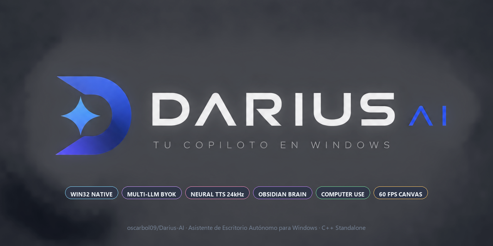

<p align="center">
  🇺🇸 <b>English</b> &nbsp;|&nbsp; 🇪🇸 <a href="README.es.md"><b>Español</b></a>
</p>

<p align="center">
  
</p>

# Darius AI

<p align="center">
  <a href="https://github.com/oscarbol09/Darius-AI/releases/latest"></a>
  <a href="https://github.com/oscarbol09/Darius-AI"></a>
  <a href="https://github.com/oscarbol09/Darius-AI"></a>
  <a href="https://oscarbol09.github.io/Darius-AI/"></a>
  <a href="https://github.com/oscarbol09/Darius-AI/releases/latest"></a>
</p>

> 📖 **Official Documentation Website:** [oscarbol09.github.io/Darius-AI](https://oscarbol09.github.io/Darius-AI/)  
> 🚀 **Want to run Darius AI without installing Python?** Download the official installer **[DariusAI-Setup-Latest.exe](https://github.com/oscarbol09/Darius-AI/releases/latest)** from GitHub Releases. It installs under your user profile in seconds with zero administrator prompts required.

**Darius AI** is a native Windows desktop assistant and tactical voice copilot built around a BYOK (*Bring Your Own Key*) multi-LLM router, dual-language **English & Spanish (i18n)** voice and UI support, anthropomorphic GUI automation, a local **Obsidian** Markdown memory brain, and a hardware-accelerated 60 FPS Cybernetic Bento HUD.

---

## Why Darius AI Exists

Most desktop assistants route even trivial operating system commands—adjusting volume, launching local apps, checking time/date, or saving quick notes—through proprietary cloud servers. That introduces unnecessary latency, API quota drain, and total failure offline.

Darius AI is built on three engineering principles:

1. **Local-First Execution:** OS automation (window management, Windows Settings panels, Win32 media keys, process telemetry, DNS flush, Obsidian journaling) executes **100% locally** in milliseconds via native Windows APIs and `shell=False` subprocess calls without touching external networks.
2. **Model Freedom (BYOK):** For open-ended reasoning, screen vision, or coding workflows, connect any LLM provider you prefer: Google Gemini (including Gemini Live full-duplex audio), OpenAI, Groq, NVIDIA NIM, OpenRouter, Antigravity Agent, or local **Ollama** instances.
3. **Bilingual by Design (EN / ES):** Switch seamlessly between **English** and **Spanish** in Settings (`⚙ Settings`) or `config.json`. The UI HUD, system prompts, speech recognition (STT), Edge-TTS neural voices, butler persona, and local regex command router all adapt automatically.

---

## Core Modules & Architecture

- **Dual-Language Internationalization Engine (`core/i18n.py`, `core/darius_persona.py`):**
  - Thread-safe `I18nEngine` singleton with instant observer callbacks refreshing GUI widgets (`CyberTopBar`, `CyberSidebar`, `BentoDashboardView`, `FloatingVoiceCapsule`).
  - Canonical British-butler persona engine (`DariusPersona`) delivering dry wit, contextual acknowledgments, and anti-*AI slop* voice output sanitization in both English and Spanish.
  - Bilingual command dispatcher (`_CMD_PATTERNS`) and Windows command resolver (`windows_commands.py`) matching natural voice/text phrasing in both languages.
- **Cybernetic Bento v8.5 HUD (`gui/`):**
  - **Cyber Core Visualizer (`cyber_core_visualizer.py`):** 60 FPS polar-geometry vector reactor pre-computed with NumPy over atomic `tk.Canvas` updates (`canvas.coords()` — zero `delete("all")` Tcl leaks, `<90 MB` RAM).
  - **Live Hardware Telemetry & Bento Grid (`bento_dashboard.py`):** Non-blocking CPU, RAM, Disk, and Network I/O meters alongside one-click workspace launchers.
  - **Telemetry Ticker & Floating Voice Capsule (`telemetry_bar.py`, `floating_voice_capsule.py`):** Real-time agent latency bar (`@trace_step`) and floating PTT/Name/Auto/Gemini Live dock.
- **Situational Intelligence Suite:**
  - **Orbital Radar (`orbital_radar.py`):** Real-time ISS telemetry, spherical Haversine distance, and azimuthal bearing with Anti-SSRF validation.
  - **ADS-B Air Traffic Sentinel (`air_traffic_sentinel.py`):** Live surrounding aircraft tracking via OpenSky Network and adsb.lol.
  - **Seismic Sensor (`seismic_sensor.py`):** Real-time USGS GeoJSON global earthquake monitoring ($M \ge 4.5$) with tsunami alerts.
  - **Space Weather Oracle (`space_weather_oracle.py`):** NOAA SWPC planetary Kp index and geomagnetic storm categorization (`G0`–`G5`).
  - **News & Science & Lexicon Oracles (`news_sentinel.py`, `science_oracle.py`, `lexicon_oracle.py`):** Multi-tier news fallback, Wikimedia REST + 15 physical constants, and bilingual technical dictionary.
- **Win32 Workspaces, Media & Input Automation (`system/`, `automation/human_input.py`):**
  - Multi-monitor enumeration (`EnumDisplayMonitors`), window snapping (`snap_window_to_monitor`), and IDE focus (`Cursor.exe`, `Code.exe`) via `AttachThreadInput`.
  - Pre-configured routines: **Darius Protocol**, **Dev Mode**, and **Trading Mode**.
  - Global Win32 media keys (`play_pause`, `next`, `prev`, `mute`, PyCAW master volume) and Wake-on-LAN Multi-NIC magic packet dispatcher (`wol_dispatcher.py`).
  - Human-like Bezier mouse movement, clicking, typing, and tokenized hotkeys in `automation/human_input.py`.
- **Multi-Engine Voice Synthesis & Acoustic Triggers (`audio/`):**
  - Hierarchical TTS worker (`tts_worker.py`): **ElevenLabs** (24kHz PCM + SHA-256 disk cache) -> **Edge-TTS** (`en-GB-RyanNeural`, `en-US-JennyNeural`, `es-MX-DaliaNeural`, `es-ES-AlvaroNeural`) -> **Windows SAPI5** offline fallback, with <100ms Win32 MCI + `sounddevice` **Barge-In** on `Escape`.
  - **In-Memory Procedural SFX (`sound_effects.py`):** Real-time sine/square/triangle waveforms via NumPy (0 KB on disk, <5ms latency).
  - **Acoustic Double-Clap Trigger (`acoustic_trigger.py`):** Adaptive RMS noise-floor double-clap wake word with auto-probe for muted microphones.
- **Obsidian Second Brain, Research & Agent Planning (`core/`):**
  - **Obsidian Vault Integration (`obsidian_brain.py`):** Appends timestamped daily notes (`Diario/YYYY-MM-DD.md`), stores permanent YAML-frontmatter memories (`Darius/Memorias/`), and auto-injects relevant vault notes into LLM prompts.
  - **Morning Digest & OSINT Dossiers (`daily_digest.py`, `target_dossier.py`):** Spoken executive summaries and structured intelligence dossiers (`Exa API` / DuckDuckGo).
  - **Deep Research, Screen Vision OCR, DAG Workflows & Agent Planner (`deep_research_agent.py`, `screen_vision.py`, `visual_intel_ocr.py`, `workflow_dag.py`, `agent_planner.py`, `complexity_router.py`).**
- **Defense-in-Depth Security & Sandboxing:**
  - **DPAPI Secret Encryption (`config_loader.py`):** Encrypts API keys at rest on Windows using `CryptProtectData` / `CryptUnprotectData` (`dpapi:` prefix), keeping `config.template.json` sanitized.
  - **Anti-SSRF, Injection Scanner & Credential Stripper (`security_guard.py`):** Blocks private/RFC 1918/cloud metadata hosts (`169.254.169.254`), detects prompt injection attempts, and redacts API tokens without corrupting legitimate MD5 hashes or UUIDs.
  - **AST-Validated Sandbox (`safe_code_interpreter.py`):** Validates syntax trees statically, blocks dunder introspection (including inside `str.format()` strings), and isolates execution timeouts.
  - **Human-in-the-Loop Approvals & Tactical Lockdown (`approval_store.py`, `darius_lockdown.py`):** SQLite WAL confirmation store and instant `user32.LockWorkStation()` privacy lockdown.

---

## System Requirements

- **OS:** Windows 10 (build 19041+) or Windows 11.
- **Python:** 3.11 or 3.12 (when running from source).
- **Audio:** Active microphone and speakers/headphones configured as Windows defaults.
- **Obsidian (Optional):** Link any local vault path to enable journal/memory injection.
- **Ollama (Optional):** Run 100% offline local LLMs without cloud keys.

---

## Quick Start (From Source)

```powershell
git clone https://github.com/oscarbol09/Darius-AI.git
cd Darius-AI

python -m venv .venv
.venv\Scripts\activate

pip install -r requirements.txt
python main.py
```

### First-Run Setup in UI
1. Click **⚙ Settings** in the top bar (or press `Ctrl+,`).
2. Select your **Interface & Voice Language** (`English (en)` or `Español (es)`).
3. In the **🤖 AI Model (BYOK)** tab, pick your provider (Gemini, OpenAI, Groq, NVIDIA NIM, OpenRouter, Ollama, or Custom), enter your key (not needed for Ollama), and test latency.
4. In the **🔊 Voice & Synthesis (TTS)** tab, pick **SAPI5** (offline), **Edge-TTS** (free neural), or **ElevenLabs** (high-fidelity neural), then click **Save & Apply**.

---

## Standalone `.EXE` Build (Nuitka + Inno Setup)

Darius AI compiles to native C via **Nuitka** so end users need no Python installation:

```powershell
pip install nuitka zstandard
python build_nuitka.py
```

To build the Windows user-space installer (`%LOCALAPPDATA%\Programs\DariusAI`, zero UAC admin prompt) using [Inno Setup 6](https://jrsoftware.org/isdl.php):

```powershell
iscc installer.iss
```

---

## Supported LLM Providers (BYOK)

| Provider | Key Identifier | Default Model | Endpoint Base | Env Variable |
| :--- | :--- | :--- | :--- | :--- |
| **Google Gemini** | `gemini` | `gemini-3.5-flash-lite` | Native Google GenAI SDK | `GEMINI_API_KEY` |
| **Antigravity Agent** | `antigravity` | `antigravity-core` | Native `google-antigravity` SDK | `GEMINI_API_KEY` / `ANTIGRAVITY_API_KEY` |
| **OpenAI / ChatGPT** | `openai` | `gpt-4o-mini` | `https://api.openai.com/v1` | `OPENAI_API_KEY` |
| **Groq Cloud** | `groq` | `llama-3.3-70b-versatile` | `https://api.groq.com/openai/v1` | `GROQ_API_KEY` |
| **NVIDIA NIM** | `nvidia` | `nvidia/llama-3.1-nemotron-70b-instruct` | `https://integrate.api.nvidia.com/v1` | `NVIDIA_API_KEY` |
| **OpenRouter** | `openrouter` | `openrouter/free` | `https://openrouter.ai/api/v1` | `OPENROUTER_API_KEY` |
| **Ollama (Local)** | `ollama` | `llama3.2:3b` | `http://localhost:11434/v1` | *(None required)* |
| **Custom** | `custom` | *Configurable* | *Configurable* | *Via modal or config.json* |

---

## Bilingual Voice & Text Commands (EN / ES)

All core local commands respond in natural English or Spanish:

| English Trigger | Spanish Trigger | Action Executed | Module |
| :--- | :--- | :--- | :--- |
| **"What time is it?"** | *"¿Qué hora es?"* | Announces local system time | `gui/app.py` |
| **"What is today's date?"** | *"¿Qué fecha es hoy?"* | Announces formatted local date | `gui/app.py` |
| **"Darius protocol"** | *"Protocolo Darius"* | Launches IDE, dual-monitor tools, music & greeting | `system/workspace_manager.py` |
| **"Dev mode"** / **"Trading mode"** | *"Modo desarrollo"* / *"Modo trading"* | Arranges multi-monitor dev or finance layouts | `system/workspace_manager.py` |
| **"Show monitors"** | *"Ver monitores"* | Reports Win32 monitor topology and resolutions | `system/workspace_manager.py` |
| **"What is on my screen?"** | *"¿Qué hay en mi pantalla?"* | Atomic `mss` capture + multimodal AI vision | `core/screen_vision.py` |
| **"Deep research on [topic]"** | *"Investiga a fondo sobre [tema]"* | Multi-source web research + cited Obsidian note | `core/deep_research_agent.py` |
| **"Create a plan for [goal]"** | *"Planifica [meta]"* | Decomposes goals into chained executable steps | `core/agent_planner.py` |
| **"Write in my diary that..."** | *"Anota en mi diario que..."* | Appends timestamped entry to Obsidian daily note | `core/obsidian_brain.py` |
| **"Remember that..."** | *"Recuerda que..."* | Saves permanent tagged memory note in Obsidian | `core/obsidian_brain.py` |
| **"Volume up / down / mute"** | *"Subir / bajar volumen / silenciar"* | Controls Windows master audio via PyCAW | `system/windows_commands.py` |
| **"Flush DNS"** / **"Top processes"** | *"Limpiar DNS"* / *"Top procesos"* | Executes Windows network/process diagnostics | `core/agentic_bridge.py` |
| **"Open [app / settings]"** | *"Abre [app / ajustes]"* | Fuzzy-matches Windows apps & `ms-settings:` panels | `system/windows_commands.py` |

---

## System Architecture

```
┌─────────────────────────────────────────────────────────────────────────────┐
│                       PRESENTATION LAYER (GUI HUD v8.5)                     │
│        CustomTkinter · Dark Bento Theme · High-DPI Per-Monitor v2           │
│   ┌───────────────────────────────────┐  ┌───────────────────────────────┐  │
│   │       CyberCoreVisualizer         │  │      BYOKSettingsModal        │  │
│   │  NumPy 60 FPS · Atomic Canvas     │  │  BYOK + TTS + EN/ES Switcher  │  │
│   └───────────────────────────────────┘  └───────────────────────────────┘  │
│   [CyberTopBar: System/Net/AI Pill]      [TelemetryBar: HUD Latency Ticker] │
│   [CyberSidebar: 6 Bento Views]          [FloatingVoiceCapsule: PTT/Live]   │
├─────────────────────────────────────────────────────────────────────────────┤
│                    TRIGGERS, I18N & COMMAND DISPATCHER                      │
│  ┌──────────────────────┐  ┌───────────────────────┐  ┌──────────────────┐  │
│  │  Acoustic Trigger    │  │   Bilingual Router    │  │   BYOK AI Engine │  │
│  │ (Double-Clap RMS)    │  │   (_CMD_PATTERNS)     │  │  (ai_client.py)  │  │
│  └──────────────────────┘  └───────────────────────┘  └──────────────────┘  │
│       Streaming Thread            Main Thread              Daemon Thread    │
├─────────────────────────────────────────────────────────────────────────────┤
│           PERCEPTION, PROCEDURAL AUDIO & WORKSPACE ORCHESTRATION            │
│  ┌──────────────────────┐  ┌───────────────────────┐  ┌──────────────────┐  │
│  │   Webcam Sentinel    │  │  Procedural Audio SFX │  │  WorkspaceManager│  │
│  │  (Presence <1% CPU)  │  │  (In-Memory NumPy)    │  │   (Win32 User32) │  │
│  └──────────────────────┘  └───────────────────────┘  └──────────────────┘  │
├─────────────────────────────────────────────────────────────────────────────┤
│                  AGENTIC INTELLIGENCE & VOICE SYNTHESIS                     │
│  ┌──────────────────────┐  ┌───────────────────────┐  ┌──────────────────┐  │
│  │    Agent Planner     │  │    Target Dossier     │  │    TTSWorker     │  │
│  │ (DAG / @trace_step)  │  │ (OSINT / Exa API)     │  │(11Labs/Edge/SAPI)│  │
│  └──────────────────────┘  └───────────────────────┘  └──────────────────┘  │
├─────────────────────────────────────────────────────────────────────────────┤
│                     LOCAL SECOND BRAIN & SECURITY GUARD                     │
│       obsidian_brain.py · security_guard.py · safe_code_interpreter.py      │
└─────────────────────────────────────────────────────────────────────────────┘
```

### Key Architectural Trade-offs

- **Why `tk.Canvas` + NumPy instead of Electron or WebView?** Embedding Chromium would add hundreds of megabytes of baseline RAM overhead. Pre-computing harmonics in NumPy and mutating canvas primitives atomically keeps the entire desktop footprint lightweight (~90 MB RAM) at a locked 60 FPS.
- **Why OpenAI-compatible `urllib` transport for BYOK?** Calling standard REST endpoints directly avoids bundling bloated third-party SDKs for every provider while still supporting OpenAI, Groq, NVIDIA NIM, OpenRouter, vLLM, and Ollama uniformly.
- **Why plain Markdown in Obsidian?** Your memories remain completely portable, versionable in Git, and readable without proprietary databases or cloud lock-in.

---

## Known Limitations

- **Windows Only:** Core subsystems bind directly to Win32 APIs (`pywin32`, `SAPI.SpVoice`, `win32event.CreateMutex`, `PyCAW`, `CryptProtectData`). Linux and macOS runtime execution are not supported.
- **Global Push-to-Talk Elevation:** Global keyboard hook capture via `keyboard` requires Windows administrator elevation when the hotkey is pressed while non-elevated foreground apps (such as admin terminals or games) hold focus.
- **Ollama Daemon:** Using offline Ollama models requires `ollama serve` (or the Ollama tray app) to be running locally.

---

## Development, Testing & Diagnostics

```powershell
# Install dev & test dependencies
pip install -r requirements-dev.txt

# Non-destructive system self-test (audio, monitors, Obsidian, BYOK, vision, contracts)
python main.py --self-test

# Run full hermetic unit/integration test suite with coverage (80% minimum enforced)
pytest tests/ -v -m "not live"

# Lint, format check, and strict win32 static type check
ruff check .
ruff format --check .
mypy src/
```

---

## License & Authorship

Released under the **GNU General Public License v3.0 (GPL-3.0)**. See [LICENSE](LICENSE) for full terms.

- **Author & Lead Maintainer:** [@Oscarbol09](https://github.com/oscarbol09)
- **Repository:** [github.com/oscarbol09/Darius-AI](https://github.com/oscarbol09/Darius-AI)
- **Security Policy:** See [SECURITY.md](SECURITY.md) for DPAPI encryption, Anti-SSRF, AST sandboxing, and reporting details.
- **Contributing:** See [CONTRIBUTING.md](CONTRIBUTING.md) and our open [`help wanted` issues](https://github.com/oscarbol09/Darius-AI/issues?q=is%3Aissue+is%3Aopen+label%3A%22help+wanted%22).
